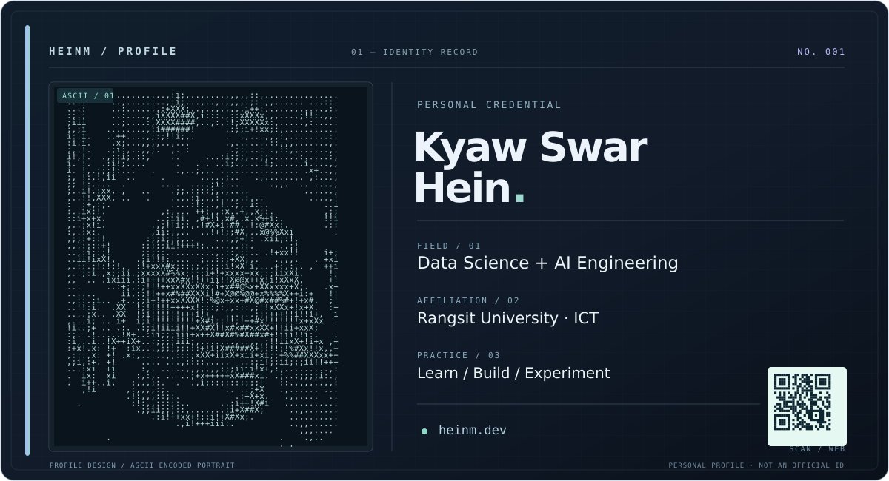

<!-- Identity card -->
<table>
  <tr>
    <td width="39%" valign="top">
      
    </td>
    <td width="61%" valign="top">
      <h2>Kyaw Swar Hein</h2>
      
<strong>AI · Data Science · Software Engineering</strong>

      
01 / AFFILIATION 
      Final-year ICT student · Rangsit University

      
02 / PRACTICE 
      Data Science · Artificial Intelligence · Machine Learning 
      <em>Learn / Build / Experiment</em>

      
03 / SELECTED WORK 
      <a href="https://github.com/kyawswarheinm/Customer-Behavior-Analysis">Customer Behavior Analysis</a> · Computer Vision 
      <a href="https://github.com/kyawswarheinm/Pantip-Sentiment">Pantip SET Sentiment</a> · NLP 
      <a href="https://github.com/kyawswarheinm/Hospitality-ERP-Analytics-Dashboard">Hospitality ERP Analytics Dashboard</a> · BI 
      <a href="https://github.com/kyawswarheinm/IoT-Sonar-System-NodeMCU-Ultrasonic-Servo">IoT Sonar System</a> · Embedded Systems

      
04 / COORDINATES 
      <a href="https://heinm.dev">Website</a> ·
      <a href="mailto:heinm.dev@gmail.com">Email</a> ·
      <a href="https://linkedin.com/in/kyawswarheinm">LinkedIn</a> ·
      <a href="https://www.kaggle.com/kyawswarheinm">Kaggle</a>

    </td>
  </tr>
</table>

### 00 / Field notes

👋 Hi, I'm Kyaw Swar Hein

I'm a final-year ICT student passionate about Data Science, Artificial Intelligence and more. Most of my projects start with a simple question: *"What happens if I try this?"* and end with a lot of experimentation, debugging, and the occasional late-night breakthrough.

My goal is to keep growing into a stronger Data Scientist and AI practitioner. Feel free to explore the repositories, check out the featured projects, and follow along as I continue learning, building, and occasionally teaching computers to do things they probably shouldn't. 🤖

*.... As always, `WW91IGFyZSBsb3ZlZCBhbmQgeW91IGFyZSB2YWx1ZWQu`*

### 01 / GitHub activity

  

### 02 / Random dev quote

  

