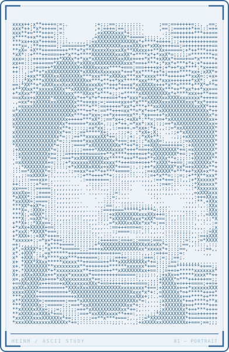

<!-- HEINM / Technical Dossier -->

<table>
<tr>
<td width="35%" valign="top">
<picture>
<source media="(prefers-color-scheme: dark)" srcset="./assets/portrait-dark.svg" />

</picture>
</td>
<td width="65%" valign="top">
<a href="https://heinm.dev">heinm.dev</a> / PROFILE
<h3>Kyaw Swar Hein</h3>
<strong>Data Science / AI Engineer</strong> 
◉ Open to Collaboration

01 / HACKATHON RECORD 
<strong>01 / 03</strong> Wins / Participations

02 / CURRENTLY LEARNING 
<code>01</code> Advanced Machine Learning 
<code>02</code> Statistics &amp; Experimentation 
<code>03</code> GTM Engineering

</td>
</tr>
</table>

  <em>“If I can imagine it, I can build it.”</em>

&nbsp;&nbsp;&nbsp;&nbsp;
&nbsp;&nbsp;&nbsp;&nbsp;
&nbsp;&nbsp;&nbsp;&nbsp;

<strong>00 / Field Notes</strong>

👋 Hi, I'm Kyaw Swar Hein

I'm a final-year ICT student passionate about Data Science, Artificial Intelligence and more. Most of my projects start with a simple question: *"What happens if I try this?"* and end with a lot of experimentation, debugging, and the occasional late-night breakthrough.

My goal is to keep growing into a stronger Data Scientist and AI practitioner. Feel free to explore the repositories, check out the featured projects, and follow along as I continue learning, building, and occasionally teaching computers to do things they probably shouldn't. 🤖

*.... As always, `WW91IGFyZSBsb3ZlZCBhbmQgeW91IGFyZSB2YWx1ZWQu`*

### 01 / GitHub Activity

<picture>
<source media="(prefers-color-scheme: dark)" srcset="https://github-profile-summary-cards.vercel.app/api/cards/profile-details?username=kyawswarheinm&amp;theme=github_dark&amp;title_color=91bdd9&amp;text_color=c9d1d9&amp;bg_color=0d1117&amp;border_color=336699&amp;chart_color=336699" />

</picture>

<strong>02 / Random Dev Quote</strong>

<picture>
<source media="(prefers-color-scheme: dark)" srcset="https://quotes-github-readme.vercel.app/api?type=horizontal&amp;theme=github_dark&amp;quoteColor=c9d1d9&amp;authorColor=91bcd9&amp;backgroundColor=0d1117&amp;symbolColor=336699" />

</picture>

